# AVT-8710 (green): sample field trial

**Full report:** [https://jordancrombie.github.io/TBT/samples/avt-8710-green/report.html](https://jordancrombie.github.io/TBT/samples/avt-8710-green/report.html) (re-written from the saved trial, which doesn't keep the waveforms; every other part is there; self-contained, about 2 MB; [source](report.html))

| | |
|---|---|
| Trial | 2026-10-25 11:45 · 83 runs · `20261025-114542_suite_avt-8710-green.json` |
| Generator | firmware ntsc-gen 0.6.0 · levels 5 / 92 (sync / white code) · colour_under |
| Graded as | frame TBC (provisional thresholds, [docs/design.md](../../design.md)) |
| **Score** | **40 / 100** (B 33 · C 38 · F 33 · H 29 · L 70 · S 54 · V 0 · X 70) |
| Fingerprint | [fingerprints/avt-8710-green.json](../../../fingerprints/avt-8710-green.json) |

### V0, every output field (clean input)

Each cell is one output field, numbered by the frame it carried. Grey: our picture; amber: ghosted or went back a frame; dark grey: blank; red: garbled; purple (B): the TBC's own pattern. A clean output shows every frame twice, in order.

### S10 rung 11, output fields while input fields are lost

Each cell is one output field, numbered by the frame it carried. Grey: our picture; amber: ghosted or went back a frame; dark grey: blank; red: garbled; purple (B): the TBC's own pattern. A clean output shows every frame twice, in order.

## Grades

✅ pass · 🟡 marginal · ❌ fail · ℹ️ not graded

| Test | | Result | Rungs |
|---|---|---|---|
| V0 | clean baseline | rung 1: fail | r1❌ |
| H1 | random line jitter | passes up to rung 2 of 6 | r1✅ r2✅ r3❌ r4❌ r5❌ r6❌ |
| H2 | sinusoidal jitter | rung 3: pass | r3✅ |
| H3 | timing step | rung 5: fail | r5❌ |
| H4 | head-switch skew | rung 5: fail | r5❌ |
| H5 | displaced single line | rung 4: fail | r4❌ |
| H6 | jitter frequency sweep | 3 of 5 rungs passed | r1✅ r2❌ r3❌ r4🟡 r5🟡 |
| F1 | clock offset | rung 3: pass | r3✅ |
| F2 | H not locked to subcarrier | rung 5: fail | r5❌ |
| F3 | slow H-rate drift | rung 2: fail | r2❌ |
| S1 | sync amplitude | rung 5: fail | r5❌ |
| S2 | slow sync edges | rung 3: pass | r3✅ |
| S3 | missing H syncs | rung 5: pass | r5✅ |
| S4 | malformed vertical interval | 2 of 2 rungs passed | r3✅ r6🟡 |
| S5 | progressive 240p | rung 1: pass | r1✅ |
| S6 | line count per field | 1 of 2 rungs passed | r5❌ r6✅ |
| S7 | dropped field | rung 4: fail | r4❌ |
| S8 | field-length wow | rung 5: pass | r5✅ |
| S9 | search noise bar | rung 4: fail | r4❌ |
| C1 | burst amplitude | 2 of 4 rungs passed | r1✅ r2❌ r3❌ r4✅ |
| C2 | no burst | rung 1: fail | r1❌ |
| C3 | burst/chroma phase jitter | fails from rung 1 | r1❌ r2❌ r3❌ r4❌ |
| C4 | hue offset | rung 3: pass | r3✅ |
| L1 | dropouts | rung 4: pass | r4✅ |
| L2 | additive noise | passes up to rung 3 of 5 | r1✅ r2✅ r3✅ r4❌ r5✅ |
| L3 | 60 Hz hum | rung 3: fail | r3❌ |
| L4 | video level | rung 4: pass | r4✅ |
| S10 | lost fields (no signal) | passes up to rung 6 of 11 | r1🟡 r2🟡 r3🟡 r4🟡 r5✅ r6✅ r7❌ r8❌ r9❌ r10❌ r11❌ |
| S11 | lost fields (snow) | passes up to rung 7 of 11 | r1🟡 r2🟡 r3🟡 r4🟡 r5🟡 r6🟡 r7🟡 r8❌ r9❌ r10❌ r11❌ |
| B1 | captions (line 21) | fails from rung 1 | r1❌ r2❌ r3❌ |
| B2 | VBI line map | rung 1: fail | r1❌ |
| B3 | AGC pulses (copy protection) | passes up to rung 3 of 3 | r1✅ r2✅ r3✅ |
| X1 | fault hunt (stress, recovery) | 5 of 5 rungs passed | r1🟡 r2🟡 r3✅ r4✅ r5🟡 |
| V1 | no signal | not graded | r1ℹ️ |

## Fault tests

- lost fields (no signal): rides through up to 6 in a row without falling back to its own pattern or losing sync; cleanly (no garbled fields) up to 0
- lost fields (snow): rides through up to 7 in a row without falling back to its own pattern or losing sync; cleanly (no garbled fields) up to 0

---

Written by `tools/sample_report.py` from the saved trial. What each test does: [docs/tests.md](../../tests.md). How these samples are laid out for GitHub: [docs/samples/README.md](../README.md).
